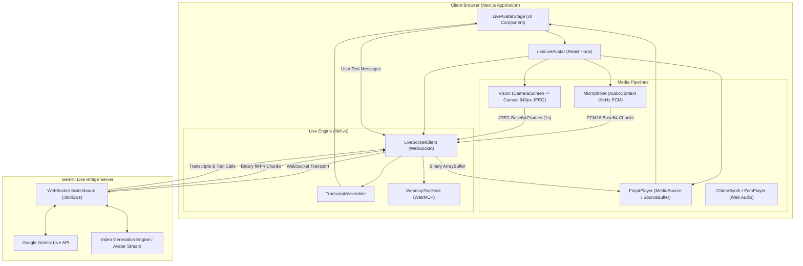
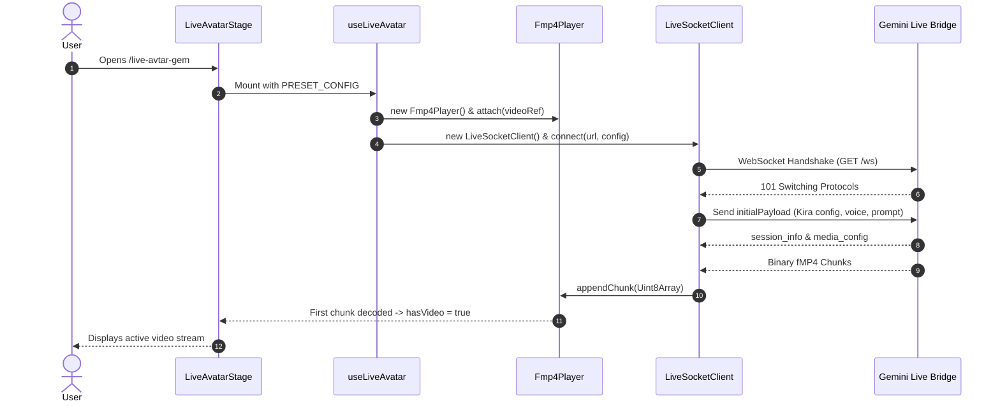
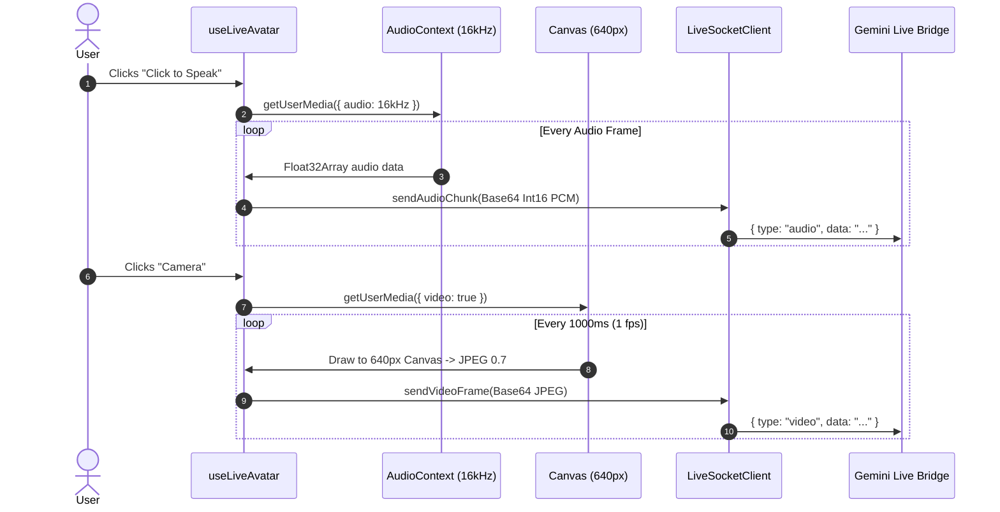
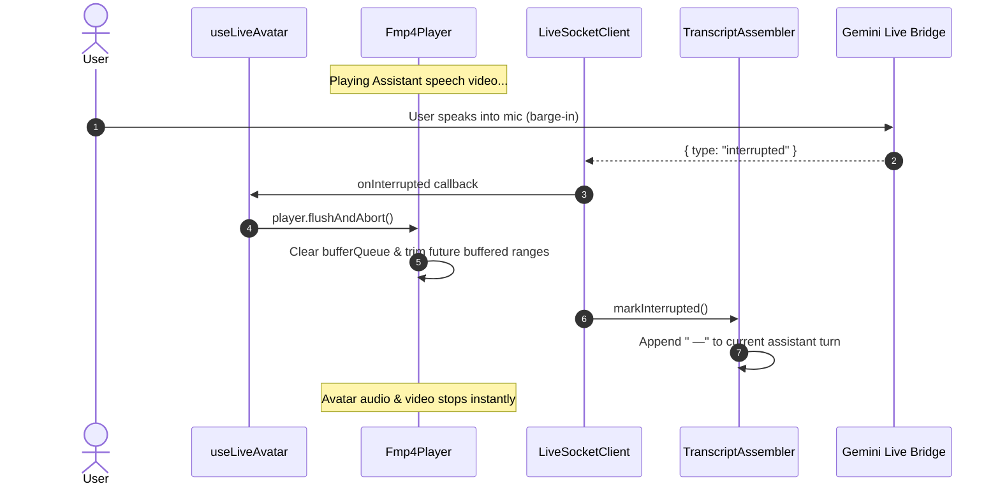

# Live Avatar Gemini (`live-avtar-gem`) — Technical Documentation

## 1. Overview & Purpose

The **Live Avatar Gemini** (`/live-avtar-gem`) module is an enterprise-grade, real-time multimodal interactive avatar experience within INT Voice Solutions. It pairs **Google Gemini Live**'s conversational intelligence and low-latency audio/vision capabilities with live animated avatar video streaming, bidirectional full-duplex voice communication, camera/screen vision streaming, tool execution via the **Web Model Context Protocol (WebMCP)**, and synchronized real-time transcripts.

### Key Highlights
- **Bidirectional Multimodal Communication:** Streams 16 kHz PCM microphone audio, 1 fps downsampled vision frames (camera or screen share), and user text messages to the Gemini Live bridge backend.
- **Ultra-Low Latency Video Streaming:** Ingests fragmented MP4 (fMP4) binary chunks via a custom HTML5 `MediaSource` / `SourceBuffer` player (`Fmp4Player`) with dynamic PTS gap jumping and memory quota eviction.
- **Instant Barge-In (Interruption Handling):** When the user interrupts the avatar, the player immediately aborts in-flight buffer appending, trims buffered future media, and annotates the live transcript with interruption markers (`—`).
- **WebMCP Tool Hosting:** Embedded client for the Web Model Context Protocol (`document.modelContext`), allowing the Gemini model to discover and execute browser-side client tools with schema validation, caller origin verification, and in-flight request deduplication.
- **Zero-Dependency Procedural Audio:** Synthesizes warm auditory cues and turn confirmation tones directly using the Web Audio API (`ChimeSynth`), eliminating external audio asset dependencies.

---

## 2. Architecture & System Flow



---

## 3. Directory & File Structure

All source files for this module reside under `app/live-avtar-gem/`:

```
app/live-avtar-gem/
├── page.tsx                           # Page entry point & preset avatar configuration
├── component/
│   └── LiveAvatarStage.tsx            # Main UI stage: video view, controls, transcript
├── hook/
│   └── useLiveAvatar.ts               # Core React orchestrator hook (media, WebSocket, state)
└── lib/live/
    ├── index.ts                       # Public barrel exports
    ├── live-socket.ts                 # Full-featured WebSocket client for Gemini Live bridge
    ├── fmp4-player.ts                 # MSE fMP4 streaming video player with barge-in & gap jumping
    ├── pcm-mic.ts                     # 16 kHz AudioWorklet microphone capture
    ├── pcm-player.ts                  # 24 kHz gapless PCM audio player with visualizer tap & mute
    ├── transcript-assembler.ts        # Streaming transcript & tool-call cards accumulator
    ├── webmcp-host.ts                 # Web Model Context Protocol client & execution host
    ├── chime-synth.ts                 # Procedural Web Audio sound cue synthesizer
    └── live.test.ts                   # Unit tests for core library components
```

---

## 4. Component & Module Breakdown

### 4.1 Route Page (`app/live-avtar-gem/page.tsx`)
Initializes the avatar experience with preset configuration:
- **Avatar Identity:** `Kira`, representing Indus Net Technologies (INT.).
- **Voice Profile:** `Aoede` (standard female Gemini Live voice). Other supported voices include `Kore`, `Leda`, and `Zephyr`.
- **System Instruction:** Sets the persona as a warm, professional digital engineering and AI solutions consultant.
- **Welcome Greeting:** Configures the opening greeting presented upon session connection.

```typescript
const PRESET_CONFIG = {
  avatarType: "preset" as const,
  avatarData: "Kira",
  voiceName: "Aoede",
  systemInstruction: "You are Kira, a warm, professional, and concise AI assistant representing Indus Net Technologies (INT.)...",
  welcomeMessage: "Hello and welcome to Indus Net Technologies! I am Kira, your AI assistant. How can I help you today?",
};
```

---

### 4.2 UI Component (`LiveAvatarStage.tsx`)
Constructs an interactive two-column stage layout:
- **Left Stage (2 Cols on lg screens):**
  - **Header:** Real-time connection beacon (pulsing green when connected, amber when connecting) and active voice name.
  - **Video Stage:** HTML5 `<video>` element managed by `Fmp4Player`. Features smooth cross-fade opacity and a loading spinner with contextual status messages.
  - **Error Toast/Banner:** Displays transient errors and session diagnostics.
  - **Bottom Control Bar:**
    - Text chat input with submit button.
    - Media vision toggles: **Camera** (`getUserMedia`) and **Screen** (`getDisplayMedia`).
    - Session lifecycle: **Reconnect** / **End Session**.
    - Audio control: **Click to Speak** / **Mute Mic**.
- **Right Stage (1 Col):**
  - **Live Transcript Panel:** Auto-scrolling feed of formatted user and assistant turns with role badges and distinction styling.

---

### 4.3 Orchestration Hook (`useLiveAvatar.ts`)
The central state machine integrating all browser APIs with the backend bridge:

```typescript
export function useLiveAvatar(config: PresetAvatarConfig): {
  videoRef: React.RefObject<HTMLVideoElement | null>;
  status: string;
  isConnected: boolean;
  hasVideo: boolean;
  isMicOn: boolean;
  isCameraOn: boolean;
  isScreenOn: boolean;
  transcript: NormalizedTranscriptItem[];
  error: string | null;
  connect: () => void;
  disconnect: () => void;
  toggleMic: () => Promise<void>;
  toggleCamera: () => Promise<void>;
  toggleScreen: () => Promise<void>;
  sendText: (text: string) => void;
};
```

#### Media Orchestration Capabilities:
1. **Audio Input:**
   - Captures microphone input at 16,000 Hz, mono channel, with `echoCancellation` and `noiseSuppression`.
   - Uses `ScriptProcessorNode` / `AudioWorklet` to convert `Float32Array` samples to `Int16Array` little-endian PCM.
   - Encodes buffers into Base64 strings and streams them via `socket.sendAudioChunk()`.
2. **Vision Streaming (Camera & Screen Share):**
   - Requests camera or screen display media stream.
   - Attaches stream to a hidden video element and samples frames via an HTML Canvas every 1,000 ms (1 fps).
   - Constrains width to 640px while maintaining the original aspect ratio.
   - Encodes frames as JPEG at 0.7 quality and transmits via `socket.sendVideoFrame()`.
   - Automatically detects stream termination (e.g. user clicks the browser's native "Stop Sharing" floating bar) and releases tracks.
3. **Video Playback Ingestion:**
   - Instantiates `Fmp4Player` and mounts the `<video>` element ref.
   - Routes incoming binary ArrayBuffers from the WebSocket directly to the player queue.
   - Flushes player buffers on barge-in (`onInterrupted`).

---

### 4.4 WebSocket Switchboard (`lib/live/live-socket.ts`)
Handles network communications over WebSocket with protocol diagnostics:
- **Connection Handshake:** On WebSocket open, immediately transmits `initialPayload` containing avatar preset config, persona instructions, and voice preferences.
- **Message Demuxing:**
  - `ArrayBuffer` -> Delivered to `onBinaryFrame` (video/audio fMP4 payload).
  - JSON objects -> Decoded and routed by `type`.
- **Supported Inbound JSON Types:**
  - `session_info`: Updates active model and datacenter region.
  - `media_config`: Dynamically informs player of incoming media codec configuration.
  - `transcript` / `output_transcript`: Assistant spoken text partials and final turns.
  - `input_transcript`: User speech-to-text transcript segments.
  - `tool_call`: Dispatched when the model initiates a function call.
  - `tool_call_cancellation`: Marks cancelled tool IDs when model changes plan.
  - `interrupted`: Signals barge-in; triggers buffer purge and transcript em-dash marking.
  - `turn_complete`: Seals active partial turns into final entries.
  - `status`: Handles session quotas (e.g. `10m Session Limit Reached`).
- **RFC 6455 Close Diagnostics (`describeCloseEvent`):**
  - Maps standard and custom WebSocket close codes:
    * `1000`: Normal closure (suppressed if user-initiated or 10-minute cap already surfaced).
    * `1007`: Invalid session payload/configuration.
    * `1009`: Message frame too large.
    * Abnormal terminations: Produces user-actionable error messages.

---

### 4.5 MSE Video Engine (`lib/live/fmp4-player.ts`)
Manages fragmented MP4 playback through HTML5 Media Source Extensions:
- **Default Codec:** `video/mp4; codecs="avc1.42C020, mp4a.40.2"` with fallback to `video/mp4; codecs="avc1.42E01E, mp4a.40.2"`.
- **Dynamic Codec Negotiation:** Supports runtime codec alterations using `sourceBuffer.changeType()`.
- **Barge-in Buffer Trimming (`flushAndAbort`):**
  - Immediately drains queued unparsed byte buffers.
  - Calls `sourceBuffer.abort()` if currently updating.
  - Calls `sourceBuffer.remove(currentTime, Infinity)` to purge scheduled future frames so stale speech/motion is cut off instantly.
- **PTS Gap Jumping:**
  - When Gemini Live pauses between turns, time gaps in Presentation Time Stamps (PTS) can cause Chrome's demuxer to hang.
  - On `updateend`, the player checks if `currentTime < latestBufferedStart - 0.1` and advances `video.currentTime` automatically to resume seamless playback.
- **Buffer Eviction:**
  - Catches browser `QuotaExceededError` exceptions.
  - Evicts played media older than 5 seconds behind the playhead (`sourceBuffer.remove(start, currentTime - 5)`).

---

### 4.6 Audio Capture (`lib/live/pcm-mic.ts`)
Provides dedicated 16 kHz AudioWorklet microphone capture:
- **Inline Worklet:** Injects an inline `Blob` AudioWorklet processor (`pcm-processor`) that buffers samples in 2,048-sample Int16 chunks (~128ms) off the main UI thread.
- **Concurrency Guard:** Implements a monotonic `startToken` counter to prevent orphaned tracks or memory leaks when toggled rapidly.
- **RMS Energy Metering:** Calculates real-time Root-Mean-Square (RMS) amplitude values in `[0, 1]` for audio visualization.
- **Soft Muting:** Enables zeroing outgoing samples while keeping hardware microphone streams warm.

---

### 4.7 Audio Player (`lib/live/pcm-player.ts`)
Low-latency 24 kHz gapless PCM audio player for raw audio streams:
- **Routing Graph:**
  `AudioBufferSourceNode` -> `AnalyserNode` -> `GainNode` -> `AudioContext.destination`
- **Audio-Reactive Muting:** When muted, gain on the output `GainNode` is set to `0`, while the `AnalyserNode` remains active. Waveform visualizers continue dancing to avatar speech even when physical sound is muted.
- **Scheduled Playhead:** Tracks `nextPlayTime` for sample-accurate scheduling.
- **Barge-In Flushing:** Stops and disconnects all in-flight source nodes instantly on interruption.

---

### 4.8 Transcript Assembler (`lib/live/transcript-assembler.ts`)
An immutable streaming state manager for speech turns and tool invocations:
- **Streaming Turn Concatenation:** Merges incoming partial tokens into active assistant turns and overwrites user partial speech entries.
- **Interruption Annotation:** Appends an em-dash (`—`) to interrupted assistant speech turns to indicate barge-in visually.
- **Tool Call Cards:** Converts `tool_call` messages into structured items (`name`, `title`, `summary`, `category`, `items`, `cancelled`).

---

### 4.9 WebMCP Host (`lib/live/webmcp-host.ts`)
Implements the Web Model Context Protocol specification for client-side tool execution:
- **Native & Fallback Support:** Uses `document.modelContext` if available (e.g. Chrome experimental flags); falls back to an internal tool registry seamlessly.
- **Security & Hijack Protection:**
  - Validates tool ownership by checking name, description, canonical JSON schema, and execution `Window` context before running.
  - Rejects unknown or third-party injected scripts attempting to register conflicting tools.
- **Dual Schema Negotiation:** Supports both Chrome 154 string-serialized JSON arguments and W3C/CG object argument calling conventions.
- **In-Flight Coalescing (`coalesceInFlight`):** Prevents duplicate modal dialogues or file pickers if the model emits duplicate tool calls in the same turn.

---

### 4.10 Procedural Audio Cues (`lib/live/chime-synth.ts`)
Pure Web Audio synthesis for auditory cues:
- **Dual-Tone Ambient Cue:** Combines a 392 Hz G4 sine wave with an optional 523.25 Hz C5 overtone shaped through an exponential gain envelope and gentle biquad low-pass filter (620 Hz – 780 Hz).
- **Turn Tone:** Brief single-frequency confirmation tone for turn start/completion.
- **Presets:** `soft`, `subtle`, and `off`.

---

## 5. Protocol & Payload Specifications

### 5.1 Outbound Messages (Client -> Server)

#### 1. Initial Handshake Payload
Sent immediately upon WebSocket connection opening:
```json
{
  "avatarType": "preset",
  "avatarData": "Kira",
  "voiceName": "Aoede",
  "systemInstruction": "You are Kira, a warm, professional...",
  "welcomeMessage": "Hello and welcome to Indus Net Technologies..."
}
```

#### 2. Microphone Audio Chunk
```json
{
  "type": "audio",
  "mimeType": "audio/pcm;rate=16000",
  "data": "<BASE64_ENCODED_INT16_LE_PCM>"
}
```

#### 3. Vision Frame
```json
{
  "type": "video",
  "mimeType": "image/jpeg",
  "data": "<BASE64_ENCODED_JPEG_IMAGE>"
}
```

#### 4. User Text Message
```json
{
  "type": "text",
  "data": "What services does Indus Net Technologies offer?"
}
```

#### 5. Tool Call Execution Result
```json
{
  "type": "tool_result",
  "id": "call-12345",
  "name": "lookup_service",
  "result": { "found": true, "details": "Enterprise AI & Cloud" },
  "execMs": 42
}
```

#### 6. Control / Session Termination
```json
{
  "type": "control",
  "action": "terminate"
}
```

---

### 5.2 Inbound Messages (Server -> Client)

| Message Type | Format | Description |
|---|---|---|
| Binary Chunk | `ArrayBuffer` | Raw fMP4 video/audio container fragments fed to `SourceBuffer`. |
| `session_info` | JSON | Contains `model` and `location` metadata. |
| `media_config` | JSON | Specifies target codecs (e.g. `codecs: "avc1.42C020, mp4a.40.2"`). |
| `transcript` / `output_transcript` | JSON | Model speech text. `finished: true` indicates end of turn. |
| `input_transcript` | JSON | Real-time speech-to-text transcript of user audio. |
| `tool_call` | JSON | Invokes a client tool (`id`, `name`, `args`). |
| `tool_call_cancellation` | JSON | Array of cancelled tool call `ids`. |
| `interrupted` | JSON | User barged in; model stopped generating. |
| `turn_complete` | JSON | Signals completion of model response turn. |
| `status` | JSON | System status alerts (e.g. `session_limit_reached`). |

---

## 6. Environment Configuration

Ensure the following variables are configured in your environment (`.env` / `.env.local` / `.env.prod`):

```bash
# WebSocket endpoint of the Gemini Live Bridge Server
NEXT_PUBLIC_LIVE_WS_URL=ws://localhost:8080/ws

# Optional: SpatialReal SDK integration tokens if using 3D avatar rendering
SPATIALREAL_API_KEY=your_spatialreal_api_key
NEXT_PUBLIC_SPATIALREAL_APP_ID=your_spatialreal_app_id
NEXT_PUBLIC_SPATIALREAL_AGENT_ID=your_spatialreal_agent_id
```

---

## 7. Lifecycle & Interaction Flows

### 7.1 Connection & Streaming Sequence



### 7.2 Voice & Vision Interaction Sequence



### 7.3 Interruption / Barge-in Sequence



---

## 8. Best Practices & Troubleshooting

### 8.1 Common Operational Scenarios

| Issue | Root Cause | Remediation |
|---|---|---|
| **Video does not start playing** | Browser Autoplay policy blocks unmuted video before user interaction. | User interaction (click) resumes audio; `LiveAvatarStage` keeps initial video muted until autoplay succeeds. |
| **"Session limit reached" (10 mins)** | Upstream Gemini Live connection cap of 10 minutes per session. | Hook captures status 1000 with `session_limit_reached` and invites user to click "Reconnect". |
| **Microphone permission denied** | User blocked mic in browser permissions or hardware issue. | Hook catches `NotAllowedError` and displays a descriptive error banner. |
| **Video stalls between turns** | Inter-turn PTS timestamp discontinuity in Chrome's demuxer. | Handled automatically by `Fmp4Player.onSourceBufferUpdateEnd()` jumping to `latestStart`. |
| **QuotaExceededError in MSE** | Long sessions exceed browser video buffer memory limits. | Handled automatically by `Fmp4Player.evictOldBufferedMedia()`, removing data older than 5 seconds behind playhead. |

---

## 9. Verification & Testing

Unit tests for the underlying live library components are located in `app/live-avtar-gem/lib/live/live.test.ts`.

Key verified components:
1. **TranscriptAssembler:** Partial turn concatenation, user turn updates, cancellation, and barge-in marking.
2. **Close Diagnostics:** RFC 6455 mapping, 1007 invalid config handling, and 1009 payload limits.
3. **PCM & Chimes:** Little-endian Int16 serialization, RMS bounds checking, and procedural chime frequencies.
4. **WebMCP Tool Host:** Tool registration, in-flight request coalescing, and security ownership validation.
